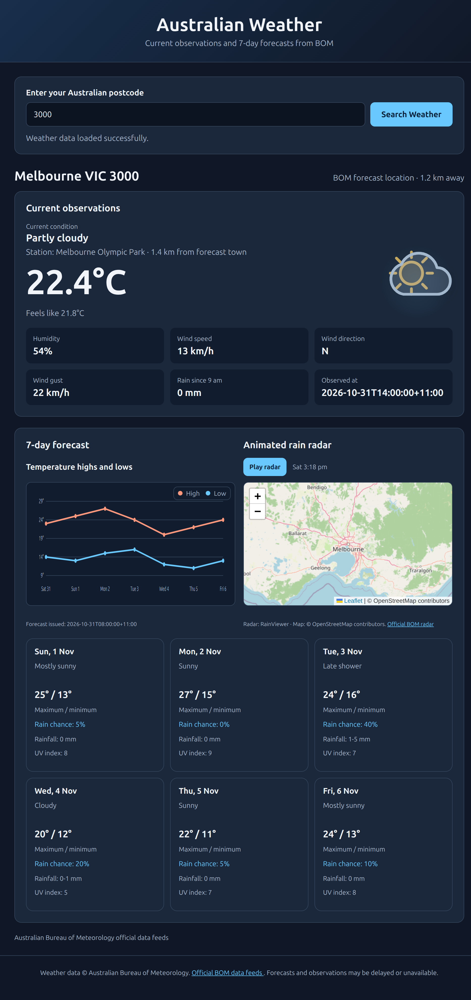

# BOM Weather

A FastAPI dashboard for Australian Bureau of Meteorology forecasts and
observations.

## Screenshots

Illustrative dashboard previews using sample values; these are not live BOM
readings.



## Build and publish to Docker Hub

Replace `YOUR_DOCKERHUB_USERNAME` with your Docker Hub username. From this
directory, build the image with a version tag and a `latest` tag:

```sh
docker build --pull \
  -t YOUR_DOCKERHUB_USERNAME/bom-weather:1.0.0 \
  -t YOUR_DOCKERHUB_USERNAME/bom-weather:latest \
  .
```

Sign in to Docker Hub and push both tags:

```sh
docker login -u YOUR_DOCKERHUB_USERNAME
docker push YOUR_DOCKERHUB_USERNAME/bom-weather:1.0.0
docker push YOUR_DOCKERHUB_USERNAME/bom-weather:latest
```

Choose whether the repository is public or private in Docker Hub. Do not put
your Docker Hub password or access token in this file or in the image.

## Run the published image

```sh
docker run -d \
  --name bom-weather \
  --restart unless-stopped \
  -p 8088:8088 \
  YOUR_DOCKERHUB_USERNAME/bom-weather:1.0.0
```

Open [http://localhost:8088](http://localhost:8088). The image includes the
postcode data bundled at build time. To rebuild with updated data, run
`convert_postcodes.py` before building the image.

## Run with Docker Compose

From this directory, build and start the app with:

```sh
docker compose up -d --build
```

The Compose setup publishes the app on port `8088` and checks its `/health`
endpoint.
